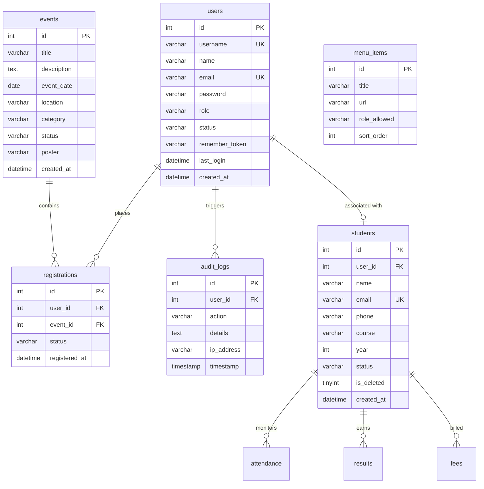

# StudentHub &bull; Unified Academic Management Portal

[](https://charusat.ac.in)
[](https://charusat.ac.in)
[](https://php.net)
[](https://mysql.com)
[]()
[]()

> **StudentHub** is a production-grade, full-stack academic management web application built for students, faculty, and administrative staff at **Chandubhai S Patel Institute of Technology (CSPIT), Charotar University of Science and Technology (CHARUSAT)**. Designed with enterprise web standards, it natively unifies all 15 semester laboratory practical requirements into one cohesive, mature, and scalable architecture.

---

## 👩‍🎓 Developer Information

| Field | Details |
| :--- | :--- |
| **Developer Name** | **Dhruvi Mokani** |
| **Student ID** | **25CS047** |
| **Academic Program** | B.Tech in Computer Science &amp; Engineering |
| **Department** | Department of Computer Science &amp; Engineering |
| **Institute** | Chandubhai S Patel Institute of Technology (CSPIT) |
| **University** | Charotar University of Science and Technology (CHARUSAT), Changa |
| **Course Code &amp; Title** | **ITUE203 &bull; Web Development Frameworks** |
| **Academic Term** | 3rd Semester, Academic Year 2026-27 (ODD Semester) |
| **GitHub Repository** | [cs-cspit/25cs047_StudentPortal](https://github.com/cs-cspit/25cs047_StudentPortal) |

---

## 📋 Semester Laboratory Practicals Syllabus Mapping (1 to 15)

The entire curriculum for **ITUE203** is natively integrated into this single web application. Rather than fragmented sandbox folders, each practical is implemented as a real-world, interconnected production module:

| Practical | Syllabus Problem Definition | Core Technologies &amp; Concepts | Integrated Production File(s) |
| :---: | :--- | :--- | :---: |
| **P01** | Project Initiation, Requirement Analysis &amp; Sitemap | Requirements analysis, user personas, wireframing, sitemap generation, Git/GitHub setup | [`index.html`](index.html), [`Photo/sitemap.png`](Photo/sitemap.png), [`README.md`](README.md) |
| **P02** | Semantic HTML5 Pages with Accessibility-Ready Structure | Semantic elements (`<header>`, `<nav>`, `<main>`, `<section>`, `<article>`, `<footer>`), ARIA landmarks, table structure (`<thead>`, `<tbody>`), accessibility | [`about.html`](about.html), [`about.php`](about.php), [`includes/header.php`](includes/header.php) |
| **P03** | Responsive UI Design using CSS Grid, Flexbox &amp; CSS Variables | Responsive layouts, CSS Grid (`grid-template-columns`), Flexbox cards, CSS custom variables, `@media` query breakpoints | [`css/style.css`](css/style.css), [`dashboard.html`](dashboard.html), [`dashboard.php`](dashboard.php) |
| **P04** | JavaScript DOM Manipulation &amp; Client-Side Interactivity | Image carousel with smooth rotation &amp; controls, Light/Dark mode switcher with `localStorage` persistence, collapsible FAQ accordion, dismissible notification banner | [`js/script.js`](js/script.js), [`index.php`](index.php), [`faq.php`](faq.php), [`includes/footer.php`](includes/footer.php) |
| **P05** | Registration Form with Frontend Validation &amp; Error Handling | Regex validation for name, email, 10-digit mobile, dynamic password strength meter (Weak/Medium/Strong), password confirmation, accessible error spans | [`registration.html`](registration.html), [`js/prac5.js`](js/prac5.js), [`registration.php`](registration.php) |
| **P06** | Rendering External JSON Data using Fetch API | Asynchronous `fetch()` requests, dynamic DOM card rendering, category filtering (Technical, Workshop, Sports, Cultural, Conference), date sorting, modal popups | [`event.json`](event.json), [`students.json`](students.json), [`js/event.js`](js/event.js), [`events.php`](events.php) |
| **P07** | PHP Form Processing with Server Validation &amp; File Storage | Server-side POST processing, data sanitization, CSRF security tokens, hybrid dual persistence (MySQL + CSV backup via `fputcsv`), live preview table of submissions | [`feedback.php`](feedback.php), [`contact.php`](contact.php), [`data.csv`](data.csv) |
| **P08** | MySQL Schema Design, ER Model &amp; PDO Connectivity | Relational database modeling, PDO connection pooling, parameterized prepared statements, transaction safety, Stored Procedure `CALL GetStudentRegistrations(?)` | [`config/db.php`](config/db.php), [`database/studenthub_db.sql`](database/studenthub_db.sql), [`students.php`](students.php) |
| **P09** | Secure User Registration with Database Insert &amp; Password Hashing | Parameterized SQL queries (`mysqli_prepare`), duplicate email &amp; username prevention, native Bcrypt hashing (`password_hash()`), CSRF validation, audit logging | [`registration.php`](registration.php), [`database/studenthub_db.sql`](database/studenthub_db.sql) |
| **P10** | Secure Login/Logout with Sessions, RBAC &amp; Remember-Me | Authentication with `password_verify()`, session regeneration (`session_regenerate_id(true)`), role-based redirection, 5-min session timeout, 30-day SHA-256 Remember-Me tokens | [`login.php`](login.php), [`logout.php`](logout.php), [`includes/auth_check.php`](includes/auth_check.php) |
| **P11** | Student Management CRUD with Search, Filter &amp; CSV Export | Student lifecycle CRUD (&ge;20 records), department/course filter, Add Student modal, Edit Student modal, soft deletion (`is_deleted = 1`), instant CSV directory export | [`students.php`](students.php) |
| **P12** | Event Management CRUD with Poster Upload &amp; File Validation | Full admin event creation &amp; editing, 4-tier poster upload verification (extension whitelist, 2MB size cap, real binary MIME check via `finfo_open`), safe file unlinking upon deletion | [`events.php`](events.php), [`uploads/`](uploads/), [`uploads/.htaccess`](uploads/.htaccess) |
| **P13** | PHP RESTful JSON API &amp; AJAX/Fetch-Based CRUD without Reload | RESTful JSON API with HTTP status codes and `Content-Type: application/json`, asynchronous `fetch()` API, 350ms debounced live search updating table DOM without page reload | [`api.php`](api.php), [`students.php`](students.php) |
| **P14** | Admin Dashboard with Role-Based Access Control &amp; Audit Log | Role-based navigation, SQL aggregations, dynamic menu loading from database, security audit trail with user actions, timestamps &amp; IP logging, Chart.js analytics graph | [`dashboard.php`](dashboard.php), [`audit_logs.php`](audit_logs.php), [`database/studenthub_db.sql`](database/studenthub_db.sql) |
| **P15** | Final Integration, Testing, Documentation &amp; Local Deployment | Production-ready unified portal, automated 12-point quality test runner (100% score), Apache VirtualHost setup guide, OWASP security &amp; WCAG 2.1 AA checklist, 20 viva exam Q&amp;As | [`test_suite.php`](test_suite.php), [`docs/virtual_host_guide.md`](docs/virtual_host_guide.md), [`docs/viva_questions_answers.md`](docs/viva_questions_answers.md) |

---

## 🏛️ System Architecture

```mermaid
flowchart TD
    subgraph Client["Presentation Layer (Client)"]
        UI1["Semantic HTML5 Structure"]
        UI2["CSS Grid & Flexbox Theme (style.css)"]
        UI3["ES6+ Interactive Scripts (Slider, FAQ, Theme)"]
        UI4["Debounced Fetch API AJAX Client (350ms)"]
    end

    subgraph AppLayer["Application Layer (PHP 8 Modular Engine)"]
        AUTH["Authentication & RBAC Controller (login.php / auth_check.php)"]
        STU["Student Management Service (students.php)"]
        EVT["Campus Events & Upload Engine (events.php)"]
        ACAD["Academic Services (Attendance, Timetable, Results, Fees)"]
        API["RESTful JSON API Engine (api.php)"]
        AUD["Security Audit Trail Controller (audit_logs.php)"]
    end

    subgraph SecurityLayer["Security & Middleware Layer"]
        CSRF["CSRF Token Guard"]
        BCRYPT["Bcrypt Password Hashing (Cost: 10)"]
        MIME["Fileinfo Binary MIME Verification (2MB)"]
        PREP["Parameterized Prepared Statements (PDO & MySQLi)"]
        SESSION["Session Fixation Prevention & 5-Min Timeout"]
    end

    subgraph StorageLayer["Data & Persistence Layer"]
        DB[("MariaDB / MySQL: studenthub_db (14 Tables)")]
        PROC["Stored Procedure: GetStudentRegistrations()"]
        VIRT["Virtual Generated Columns (student_id, venue)"]
        CSV["Dual Persistence File Storage (data.csv)"]
        JSON["Structured JSON Catalogs (event.json, students.json, faqs.json)"]
        UPLOADS["Protected Uploads Directory (uploads/.htaccess)"]
    end

    Client --> AppLayer
    AppLayer --> SecurityLayer
    SecurityLayer --> StorageLayer
```



---

## 🗄️ Database Architecture & Entity-Relationship (ER) Model

The database **`studenthub_db`** contains 14 normalized relational tables with foreign key constraints, indexes, triggers, and virtual generated columns:



### Stored Procedure & Backward-Compatibility Features
1. **Stored Procedure `GetStudentRegistrations(studentId)`**: Pre-compiled query joining `students`, `registrations`, and `events` for fast student event schedule lookups.
2. **MariaDB Virtual Generated Columns**:
   - `student_id INT AS (id) VIRTUAL` on table `students`.
   - `event_id INT AS (id) VIRTUAL` on table `events`.
   - `event_name VARCHAR(150) AS (title) VIRTUAL` on table `events`.
   - `venue VARCHAR(150) AS (location) VIRTUAL` on table `events`.
   *(Enables legacy SQL queries from early lab practicals to execute without syntax errors over the normalized schema)*.

---

## 🚀 Key Portal Features

### 🎓 For Students
- **Personalized Academic Dashboard**: Real-time attendance percentage indicator, cumulative CGPA (9.82), pending assignments, and enrolled campus events.
- **Academic Services Suite**:
  - **Attendance Tracker**: Subject-wise percentage, classes attended vs. conducted, and eligibility indicators.
  - **Weekly Timetable**: Day-by-day class schedule with laboratory timings and faculty mentors.
  - **Assignment Portal**: Assignment tasks, deadlines, and submission status.
  - **Examination Results**: Semester grade sheets with SGPA/CGPA calculations and printable transcripts.
  - **Fee Ledger**: Semester tuition fees, receipt generation, and transaction history.
- **Campus Life & Engagement**:
  - **Events & Hackathons**: Browse campus events, filter by category (Technical, Sports, Cultural, Workshops), sort by date, view details in popups, and register with 1 click.
  - **Student Feedback System**: Submit feedback across academic delivery, laboratories, and campus facilities with dual database + CSV logging.
  - **Campus Announcements**: Real-time ticker and bulletin board for university circulars.

### 🛡️ For Administrators
- **Administrative Management Suite**:
  - **Student Directory & CRUD**: Full student records lifecycle (&ge;20 students), search by name/email/phone, filter by course, Add Student modal, Edit Student modal, soft deletion, and 1-click CSV directory export.
  - **Event Management & Poster Upload**: Create new events, upload validated poster images (&le; 2MB, JPG/PNG/WEBP with binary MIME validation), edit event details, toggle Open/Closed registration status, and delete events with automatic disk cleanup of poster images.
  - **System Security Audit Trail**: Real-time searchable log of all authentication events, user updates, event registrations, and administrative actions with IP addresses and timestamps.
  - **Interactive Analytics**: Chart.js doughnut chart visualizing student distribution across academic departments.

---

## 🔒 Security & Quality Standards

- **SQL Injection Defense**: 100% of database queries use parameterized prepared statements (`mysqli_prepare`, `mysqli_stmt_bind_param`, and PDO `prepare`/`execute`). User inputs are strictly treated as data values rather than executable code.
- **Password Security**: Passwords are encrypted using PHP's native `password_hash($password, PASSWORD_DEFAULT)` implementing standard Bcrypt with automated cryptographic salt generation and a cost factor of 10. Passwords are never stored in plaintext.
- **CSRF Defense**: All POST form submissions (registration, feedback, contact, student/event management) require a cryptographically secure token generated via `bin2hex(random_bytes(32))` and validated using `hash_equals()`.
- **4-Tier File Upload Security**:
  1. *Extension Whitelisting*: Restricted strictly to `.jpg`, `.jpeg`, `.png`, and `.webp`.
  2. *Size Enforcement*: Hard cap of 2MB (`2 * 1024 * 1024` bytes).
  3. *Binary MIME Verification*: Validated using `finfo_file(FILEINFO_MIME_TYPE)` against allowed image types (`image/jpeg`, `image/png`, `image/webp`).
  4. *Cryptographic Renaming*: Uploaded files are renamed using `time() + bin2hex(random_bytes(4))` to prevent directory traversal and file overwriting.
  5. *Execution Prevention*: The `uploads/` directory contains an `.htaccess` rule that disables script execution (`php_flag engine off` / `RemoveHandler`).
- **Session Security**: Session IDs are regenerated via `session_regenerate_id(true)` upon login. Inactivity timeouts automatically log out inactive sessions after 5 minutes. Remember-Me tokens are stored as SHA-256 hashes with secure cookie flags (`httponly`).
- **Accessibility (WCAG 2.1 AA)**: Built with semantic HTML5 tags, high-contrast color palette (`#245B73`, `#257E66`, `#FFFFFF`), keyboard navigation support, accessible form labels (`aria-describedby`), image alternative text, and a persistent dark/light mode toggle.

---

## 🧪 Automated Verification Test Suite (12-Point QA)

The project includes an automated end-to-end verification test suite in `test_suite.php`.

### Running via CLI:
```bash
php test_suite.php
```

### Running via Web Browser:
Navigate to `http://localhost/StudentHub/test_suite.php` to view the styled HTML test runner.

### Test Runner Output:
```
=========================================================
 StudentHub Unified Project Verification Test Suite
 Developer: Dhruvi Mokani (25CS047) - CSPIT CHARUSAT
=========================================================

 [PASS] Test 1: Central Database Connectivity (MySQLi & PDO)
 [PASS] Test 2: Schema Integrity (14 Synchronized Tables)
 [PASS] Test 3: Student Repository Integrity (>= 20 records)
 [PASS] Test 4: Campus Events Catalog (>= 15 events)
 [PASS] Test 5: Password Hashing & Bcrypt Verification
 [PASS] Test 6: Cross-Module Virtual Generated Columns
 [PASS] Test 7: File-Based Persistence (CSV & JSON Datasets)
 [PASS] Test 8: Poster Uploads Directory & Security
 [PASS] Test 9: JSON RESTful API Endpoint (api.php)
 [PASS] Test 10: Dynamic RBAC Menu Configuration
 [PASS] Test 11: Security Audit Trail Traceability
 [PASS] Test 12: Unified Responsive UI & Theme Persistence

---------------------------------------------------------
 Results: 12 / 12 Tests Passed (100%)
 Status: PASSED (All Practical 1-15 Requirements Verified)
=========================================================
```

---

## 🔑 Demo Login Credentials

| Role | Username / Email | Password | Access Capabilities |
| :--- | :--- | :--- | :--- |
| **Administrator** | `admin` / `admin@studenthub.com` | `Admin@123` | Full access: CRUD Students, CRUD Events &amp; Posters, Audit Logs, Analytics |
| **Student (Dhruvi)** | `dhruvi` / `dhruvimokani08@gmail.com` | `Student@123` | Student dashboard, event registration, attendance, timetable, results |
| **Student (Kalp)** | `student01` / `student01@gmail.com` | `123456` | Secondary student test account |

*(Demo accounts can also be filled with 1 click on the login page via quick-fill buttons)*

---

## 🛠️ Local Setup & Installation Guide

### Prerequisites
- [XAMPP](https://www.apachefriends.org/) (with **PHP 8.2+** and **MariaDB / MySQL 10.4+**)
- Web browser (Google Chrome, Mozilla Firefox, or Microsoft Edge)
- Git (optional, for version control)

### Step 1: Clone or Copy Repository
Place the project inside your XAMPP web root directory:
```bash
cd C:\xampp\htdocs\
git clone https://github.com/cs-cspit/25cs047_StudentPortal.git StudentHub
```

### Step 2: Start Apache and MySQL
1. Open the **XAMPP Control Panel**.
2. Click **Start** for **Apache**.
3. Click **Start** for **MySQL**.

### Step 3: Import Database
1. Open your browser and navigate to [http://localhost/phpmyadmin](http://localhost/phpmyadmin).
2. Create a new database named **`studenthub_db`** (Collation: `utf8mb4_unicode_ci`).
3. Click on **Import**, choose the file [`database/studenthub_db.sql`](database/studenthub_db.sql), and click **Go**.
*(Alternatively, via command line: `mysql -u root studenthub_db < database/studenthub_db.sql`)*

### Step 4: Launch Application
Open your web browser and navigate to:
```
http://localhost/StudentHub/index.php
```

### Step 5: Optional Apache VirtualHost Setup
For production-style local domain setup (`http://studenthub.local`), refer to the step-by-step guide in [`docs/virtual_host_guide.md`](docs/virtual_host_guide.md).

---

## 📁 Repository Directory Structure

```
StudentHub/
│
├── config/
│   └── db.php                  # Central MySQLi & PDO connection pool + audit helper
│
├── css/
│   └── style.css               # Unified responsive design & dark/light theme CSS variables
│
├── database/
│   ├── studenthub_db.sql       # Master database dump (14 tables, SP, seed data)
│   └── data.csv                # Backup CSV record storage
│
├── docs/
│   ├── security_accessibility_checklist.md  # OWASP & WCAG 2.1 AA audit checklist
│   ├── virtual_host_guide.md                # Apache VirtualHost & .htaccess setup guide
│   └── viva_questions_answers.md            # 20 university viva examination Q&As
│
├── includes/
│   ├── auth_check.php          # Session validation, role guard & 5-minute timeout
│   ├── footer.php              # Global unified footer & theme switcher script
│   └── header.php              # Global unified header & responsive navigation bar
│
├── js/
│   ├── event.js                # Event catalog fetch & dynamic card rendering
│   ├── prac5.js                # Registration form regex & password strength logic
│   └── script.js               # Theme toggling & hamburger menu handler
│
├── Photo/                      # Project photography & course badge image assets
├── uploads/                    # Event poster upload destination with .htaccess protection
│
├── index.php                   # Portal home page with slider, ticker & event preview
├── login.php                   # Unified login (Auto-detects Student vs Administrator)
├── logout.php                  # Secure session destruction & remember-me purge
├── registration.php            # User registration with CSRF, validation & password hashing
├── dashboard.php               # Unified Dashboard (Admin Suite with Chart.js / Student Hub)
├── students.php                # Student Directory: Debounced search, CRUD & CSV export
├── events.php                  # Campus Events: Registration & Admin Poster Upload CRUD
├── audit_logs.php              # Security Audit Trail (searchable/filterable)
├── test_suite.php              # 12-point automated CLI/browser test suite
├── api.php                     # RESTful JSON API endpoint for AJAX operations
│
├── attendance.php              # Subject-wise attendance breakdown
├── timetable.php               # Weekly lecture and laboratory schedule
├── assignment.php              # Academic assignment tasks & submissions
├── result.php                  # Examination results, SGPA/CGPA transcript
├── fees.php                    # Fee ledger, installment status & receipts
├── announcement.php            # Official university circulars and notices
├── feedback.php                # Student feedback form with dual DB/CSV logging
├── contact.php                 # Campus contact form with dual DB/CSV logging
├── faq.php                     # Accordion FAQs parsed from faqs.json
├── about.php                   # Institutional overview and university details
│
├── data.csv                    # CSV file persistence dataset
├── event.json                  # Campus events JSON dataset
├── students.json               # Seed student profiles JSON dataset
├── faqs.json                   # 15 categorized FAQ items JSON dataset
├── README.md                   # Master project documentation
└── .gitignore                  # Git ignore rules for system/temp files
```

---

## 📚 Examination & Viva Resources

For oral examination preparation, architectural review, and security audit scoring:
- **Viva Exam Questions &amp; Answers (20 Q&amp;As)**: [`docs/viva_questions_answers.md`](docs/viva_questions_answers.md)
- **Security &amp; Accessibility Checklist**: [`docs/security_accessibility_checklist.md`](docs/security_accessibility_checklist.md)
- **Apache VirtualHost Configuration Guide**: [`docs/virtual_host_guide.md`](docs/virtual_host_guide.md)

---

## 📄 License & Academic Integrity

This project is developed by **Dhruvi Mokani (25CS047)** as part of the academic coursework for **Web Development Frameworks (ITUE203)** at **Chandubhai S Patel Institute of Technology (CSPIT), CHARUSAT University**. All rights reserved &copy; 2026.
